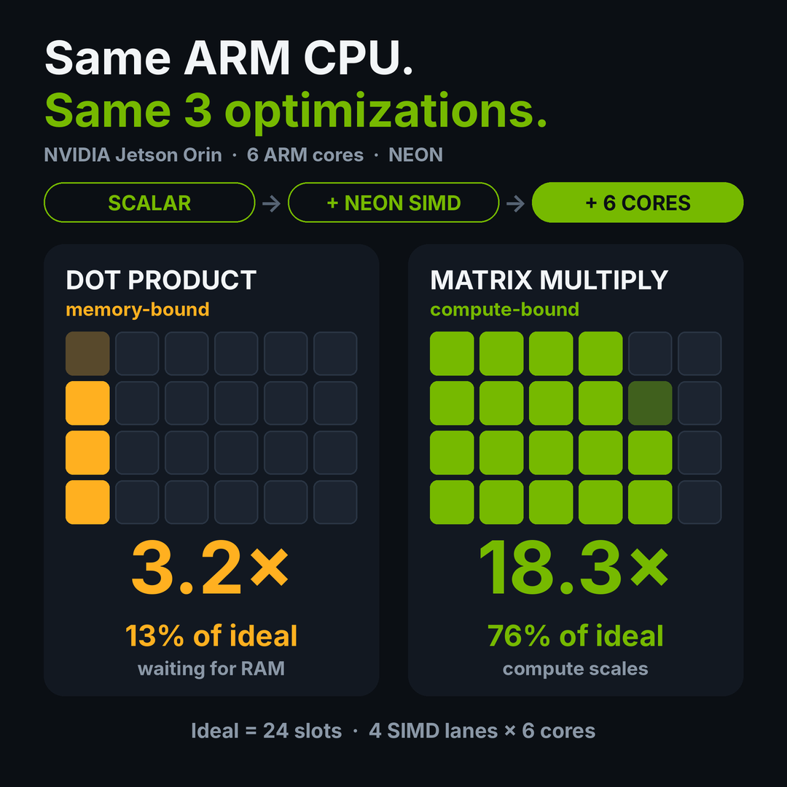

# Jetson CPU-Benchmark: Scalar vs NEON vs OpenMP



Two kernels with contrasting characteristics:

| Kernel | Type | Why |
|---|---|---|
| Dot product | Memory-bound | 1 FMA per 8 bytes loaded |
| GEMM (C = A*B) | Compute-bound | high reuse |

## Setup (conda)

```bash
conda env create -f environment.yaml
conda activate jetsonbench
make
./bench               # Dot N=16M, GEMM n=768
OMP_NUM_THREADS=1 ./bench
./bench 262144 512    # smaller N / n
```

## Variants
| Variant | What happens |
|---|---|
| scalar | `no-tree-vectorize`, purely scalar |
| auto (omp simd) | Compiler vectorizes automatically, GEMM without blocking |
| neon / neon 8x8 block | Intrinsics; GEMM with an 8x8 register tile and cache blocking (KC=256, NC=128) |
| neon + openmp | 16-row work packets distributed across all cores |

## Estimate peak FLOPs (Orin, Cortex-A78AE)
2 NEON FMA pipelines x 4 floats x 2 FLOPs = 16 FLOPs/cycle/core.
Peak = cores x GHz x 16, e.g. 1 core @ 2.0 GHz = 32 GFLOP/s.
Achieved value / peak = efficiency (good native kernels: 50-80%).

## Expectations
- **Dot:** NEON provides little improvement at large N because of the RAM limit, but more improvement in cache; threads scale only up to memory bandwidth.
- **GEMM:** NEON is close to 4x-10x faster than scalar per core (SIMD + register blocking); OpenMP scales close to the core count.
- `err` is the relative difference from the reference (a different summation order), not an error in the strict sense.
